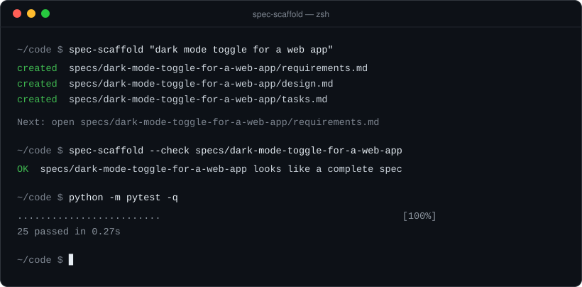

<div align="center">

# spec-scaffold

**One line of text in, a structured spec folder out.**

The same three files a spec-driven workflow expects — no blank page, no missing sections.

[](https://github.com/opnq7/spec-scaffold/actions/workflows/ci.yml)
[](https://github.com/opnq7/spec-scaffold/blob/main/pyproject.toml)
[](https://github.com/opnq7/spec-scaffold/blob/main/pyproject.toml)
[](LICENSE)



</div>

## Why

Spec-driven development works because the spec has a *shape*: an overview, user
stories, acceptance criteria written as testable statements, a design that names
its trade-offs, and tasks broken into phases you can tick off. That shape is the
tedious part — and the part people quietly skip when they are in a hurry.

`spec-scaffold` writes the shape for you. You keep the thinking.

It is deliberately small: one dependency-free package, three templates, a shallow
linter. Nothing is generated that you could not have typed, and nothing is hidden
behind a plugin system.

## Quick start

```bash
git clone https://github.com/opnq7/spec-scaffold.git
cd spec-scaffold
python -m pip install -e .
```

```console
$ spec-scaffold "dark mode toggle for a web app"
created  specs/dark-mode-toggle-for-a-web-app/requirements.md
created  specs/dark-mode-toggle-for-a-web-app/design.md
created  specs/dark-mode-toggle-for-a-web-app/tasks.md

Next: open specs/dark-mode-toggle-for-a-web-app/requirements.md and replace the placeholders.
```

Python 3.9+. No runtime dependencies.

## Usage

```text
spec-scaffold [IDEA ...] [-o DIR] [-n NAME] [-f] [--dry-run] [-q]
spec-scaffold --check SPEC_DIR [--json]
```

| Flag | Meaning |
| --- | --- |
| `-o, --out DIR` | parent folder (default `specs`) |
| `-n, --name NAME` | override the folder name instead of slugifying the idea |
| `-f, --force` | overwrite files that already exist |
| `--dry-run` | print what would be written, touch nothing |
| `-q, --quiet` | only print errors |
| `--check DIR` | lint an existing spec folder instead of creating one |
| `--json` | with `--check`: machine-readable report |
| `--version` | print the version |

Re-running is safe. Existing files are skipped, so you can regenerate one deleted
file without losing the ones you have already edited:

```console
$ spec-scaffold "dark mode toggle for a web app"
skip     specs/dark-mode-toggle-for-a-web-app/requirements.md (exists, use --force to overwrite)
skip     specs/dark-mode-toggle-for-a-web-app/design.md (exists, use --force to overwrite)
skip     specs/dark-mode-toggle-for-a-web-app/tasks.md (exists, use --force to overwrite)
```

## Checking a spec

```console
$ spec-scaffold --check specs/dark-mode-toggle-for-a-web-app
OK  specs/dark-mode-toggle-for-a-web-app looks like a complete spec
```

```console
$ spec-scaffold --check specs/half-finished
FAIL  specs/half-finished has 2 problem(s):
  - missing design.md
  - tasks.md: no '- [ ]' checkboxes left to do
```

The check is structural on purpose — it catches *deleted* sections, not bad
writing. That is the failure mode a linter is actually good at.

| Exit code | Meaning |
| --- | --- |
| `0` | complete spec |
| `1` | incomplete spec, or a write error |
| `2` | usage error |

### In CI

```yaml
- name: Spec must be complete before merge
  run: spec-scaffold --check specs/my-feature --json
```

```console
$ spec-scaffold --check specs/my-feature --json
{
  "folder": "specs/my-feature",
  "ok": true,
  "problems": []
}
```

## What gets generated

| File | Contains |
| --- | --- |
| `requirements.md` | overview, user stories, acceptance criteria as WHEN / THE SYSTEM SHALL pairs, out-of-scope, open questions |
| `design.md` | approach and the rejected alternative, an ASCII architecture sketch, data model table, error handling, testing plan |
| `tasks.md` | three phases of `- [ ]` checkboxes, ready to tick |

A generated folder is committed under [`examples/dark-mode-toggle-for-a-web-app/`](examples/dark-mode-toggle-for-a-web-app/)
so you can read one before installing anything.

```markdown
## Acceptance Criteria

Write each criterion as a testable WHEN / THE SYSTEM SHALL pair.

- **AC-1** — WHEN <trigger>, THE SYSTEM SHALL <observable behaviour>.
- **AC-2** — WHEN <trigger>, THE SYSTEM SHALL <observable behaviour>.
```

## Case study

[`examples/pomodoro-timer/`](examples/pomodoro-timer/) is the other kind of
example: a **filled-in** spec for a real 577-line single-file Pomodoro timer, one
of those projects a model writes in one pass and nobody opens again. The spec was
written against the shipped code on purpose.

[`docs/case-study.md`](docs/case-study.md) reads the two side by side. The short
version: four acceptance criteria — timing, persistence, skip semantics,
permission timing — each map to a line of code that looks fine alone and is not,
and one of them cannot be written down without killing a bug that no amount of
clicking would reveal.

## How it works

- **`templates.py`** holds the three files as `string.Template` objects, so the
  idea, slug and date are substituted with nothing more than the standard library.
- **`cli.py`** slugifies the idea, plans the writes, and refuses to clobber
  anything unless you pass `--force`.
- **`lint.py`** reads level-2 headings and checkbox lines, nothing else.
- **`console.py`** colours four status words and switches itself off for pipes,
  redirects, and `NO_COLOR`.

## Development

```bash
python -m pip install -e ".[dev]"
pytest --cov          # 25 tests, 96% statement + branch coverage
ruff check .
```

No network access is needed to run the suite. CI runs the tests on Python 3.9,
3.12 and 3.13, plus `ruff`.

## Project layout

```text
spec_scaffold/
├── cli.py         argument parsing, slugify, scaffold(), exit codes
├── templates.py   the three markdown templates
├── lint.py        section and checkbox checks
└── console.py     ANSI colour, with a NO_COLOR escape hatch
tests/
docs/demo.svg
examples/          a real generated spec, committed
```

## Roadmap

- [ ] `--template` for other spec shapes (HTTP API, data pipeline, CLI tool)
- [ ] `--check --strict`: flag sections that still only contain placeholders
- [ ] `spec-scaffold --git`: create the folder with an initial commit
- [ ] `pipx run spec-scaffold` once it is on PyPI

## Contributing

Bug reports and small PRs welcome — see [CONTRIBUTING.md](CONTRIBUTING.md).
Nothing here is precious; if a section heading is wrong for your workflow, say so.

## License

MIT — see [LICENSE](LICENSE). Changelog in [CHANGELOG.md](CHANGELOG.md).
